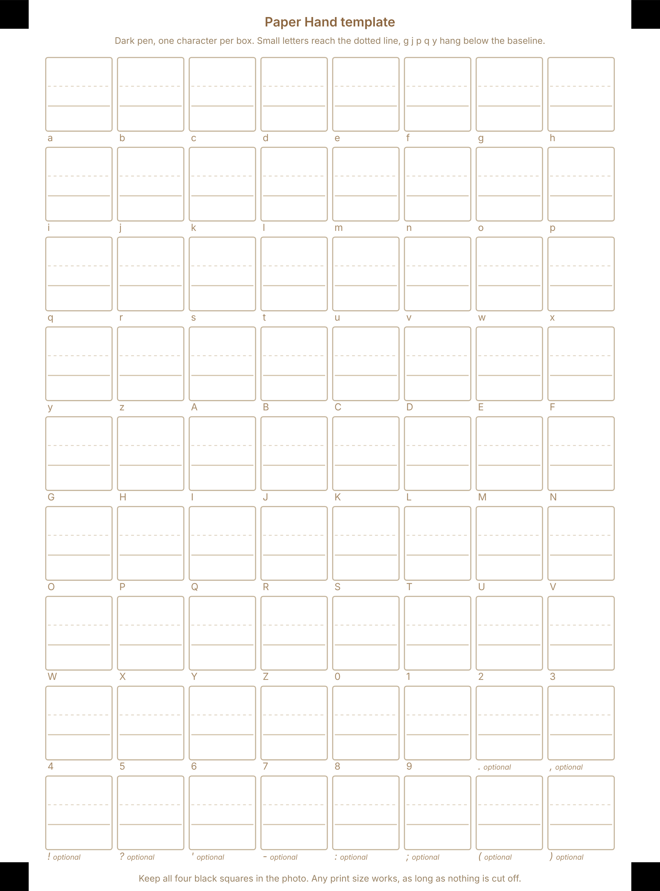

# Paper Hand

Turn a photo of your handwriting into a font.

Paper Hand is a single web page. You print a sheet, write each letter in its box, take a photo, and the page makes a font from it. It was made for [Paper](https://github.com/taylor-fang/Paper), the writing app, whose side bar labels are written in a handwriting font called Paper Hand. With this page you can swap that font for your own handwriting. The font works anywhere else too: on a website, or installed on your computer.

Everything happens inside your browser. Your photo is never uploaded anywhere.

<p align="center"></p>

## Make your font

Open the page (`index.html`, or wherever it is published) and follow the five steps.

1. **Print the template.** It is one page with a box for every small letter, capital and number, plus ten optional punctuation marks. There is a PDF for Letter paper and one for A4. Any print size works, as long as the four black squares in the corners are on the page. No printer? You can rule the same grid by hand: the page explains the measurements.
2. **Write, then take a photo.** Write one character in each box with a dark pen, sitting on the light baseline like on lined paper. Small letters reach about the dotted line, and g, j, p, q and y hang below the baseline. Then take a photo of the whole sheet from straight above, or scan it.
3. **Upload the photo and line up the corners.** The page looks for the four black squares by itself and puts a circle on each. Check that each circle sits on the middle of its square, and drag it there if not (a magnifier appears while you drag). Thin outlines show where every box will be cut; they should sit on the printed boxes.
4. **Check the letters.** Every box is cut out, cleaned up and turned into smooth outlines. You see all of them at once. If strokes look broken or too thin, move the **Ink** slider right. If smudges or bits of line show up, move it left. **Clean specks** removes small dots of dust.
5. **Try it, then download.** Type anything to see it in your handwriting, give your font a name, and download:
   - **PaperHand.css**, ready to drop into Paper (see below),
   - **a .woff file**, for websites,
   - **an .otf file**, to install on your computer.

Letters keep their real size and position: capitals stay taller than small letters, and descenders stay below the line, because everything is measured from the printed baseline in each box.

## Tips for a good photo

- **Use a dark pen.** A black felt tip or gel pen is best. Pencil and light blue ink are too faint.
- **Fill the box, but stay inside it.** Write at a comfortable size, and keep every stroke inside the box outline. Strokes that touch the outline may be cut off.
- **Even light, no shadows.** Daylight near a window is ideal. Hold your phone so that neither it nor your hand casts a shadow on the sheet.
- **Straight from above.** Hold the phone flat over the page. A little tilt is fine; the page straightens it out.
- **Get the whole sheet in.** All four black squares must be in the photo. Lay the sheet flat on a plain surface.
- **Sharp, not blurry.** Tap the screen to focus before you take the picture.

## Use your font in Paper

Paper keeps its handwriting font in one file: `app/assets/PaperHand.css`.

1. Download **PaperHand.css** from step 5.
2. Replace `app/assets/PaperHand.css` in your copy of Paper with it. Keep the file name exactly the same.
3. Reload Paper. The side bar labels are now in your handwriting.

The downloaded file has the same shape as Paper's own: one `@font-face` rule that names the font "Paper Hand" and contains the whole font inline, so nothing else needs to change. The name you type in step 5 goes inside the font files; the CSS always says "Paper Hand" so that Paper finds it.

Paper shows its side bar labels in capitals, so your capital letters matter most there.

## Use your font anywhere else

On a website, put the .woff next to your page and add:

```css
@font-face {
  font-family: "My Hand";
  src: url("My-Hand.woff") format("woff");
}
body { font-family: "My Hand", serif; }
```

To use it in other apps, open the .otf file and install it (on a Mac, double-click it and choose Install Font).

## Run it yourself

There is nothing to install and no build step. Any of these work:

- **Open `index.html`** straight from your computer in a browser.
- **GitHub Pages:** in this repository's settings on GitHub, under Pages, publish from the main branch. The page is then online for anyone.
- **Any static web host**, or `python3 -m http.server` in this folder.

The page needs an internet connection once, to load [opentype.js](https://opentype.js.org) (version 1.3.4, from jsDelivr) which writes the font file, and the Inter typeface from Google Fonts.

## How it works

- **Straightening.** The four corner marks are matched to their known positions on the template, which gives a perspective transform (a homography). Each box is then sampled from the photo as if it had been scanned flat, at 12 pixels per millimetre.
- **Finding the ink.** Each box is compared with its own paper brightness, so uneven light across the sheet does not matter. The printed box lines and baseline are a light colour that falls below the ink threshold. Specks, stray printed lines and pinholes are cleaned up.
- **Tracing.** The outline of the ink is followed pixel edge by pixel edge, smoothed, simplified and fitted with curves.
- **Building the font.** One scale is used for every letter (your median capital becomes 700 units tall, out of 1000), so sizes stay true to your writing. Each glyph gets a little space on each side, set with the Letter spacing slider. The vertical metrics match Paper's own font (ascender 900, descender -300). opentype.js writes the font, and the page wraps it as WOFF.

The files:

| File | What it is |
|---|---|
| `index.html` | The page |
| `js/layout.js` | Where every box is on the template; shared by the page, the template builder and the tests |
| `js/imaging.js` | Straightening, corner mark detection, thresholding and clean-up |
| `js/trace.js` | Ink to smooth outlines |
| `js/font.js` | Outlines to a font, WOFF and CSS |
| `js/app.js` | The page's steps and controls |
| `template/` | The printable template: PDF (Letter and A4), PNG (300 dpi) and SVG |
| `tools/build-template.js` | Rebuilds `template/` from `js/layout.js` |
| `test/` | A synthetic photo maker and an end-to-end test |

## Development

Changing the layout? Edit `js/layout.js`, then rebuild the template files (needs Node and Playwright with Chromium):

```sh
node tools/build-template.js
```

The end-to-end test draws a fake filled-in sheet with a system font, photographs it in perspective (tilt, uneven light, blur, noise, JPEG), opens the page in headless Chromium, checks the automatic corner finder, drags the corner handles, and checks the font: all 62 letters and numbers with outlines, the .woff loading as a web font, descenders below the baseline, every glyph's top and bottom against where the ink really was, and the CSS against the shape of Paper's file. It needs Python with Pillow, numpy and fontTools, and Node with Playwright:

```sh
python3 test/make_sample.py test/out/sample --seed 1
node test/e2e.js test/out/sample test/out/run
# optionally compare the CSS with Paper's real file:
PAPER_CSS=../Paper/app/assets/PaperHand.css node test/e2e.js test/out/sample test/out/run
```

`make_sample.py` takes `--tilt`, `--warp`, `--ink`, `--blur` and `--skip` to make harder photos. `node test/e2e.js SAMPLE OUT --detect` only checks the corner finder.

## Limitations

- **The corner finder** works on clear photos of the whole sheet, tilted up to about 40 degrees, and reads sideways or upside-down photos the right way round. It gives up (and asks you to drag the circles) when a mark is cut off, in shadow, or when something else dark and square, like a phone, lies on the table next to the sheet. Dragging always works.
- **One shape per character.** Handwriting changes letter shapes depending on their neighbours; a font has one shape for each character, and there is no kerning.
- **Characters:** a to z, A to Z, 0 to 9 and ten punctuation marks. Accented letters are not on the template yet.
- **Ink, not pressure.** Strokes are traced as solid shapes. Very light or very thin pens may need the Ink slider moved right.

## License

MIT, see [LICENSE](LICENSE). Made for [Paper](https://github.com/taylor-fang/Paper). Fonts are built with [opentype.js](https://opentype.js.org) (MIT).
